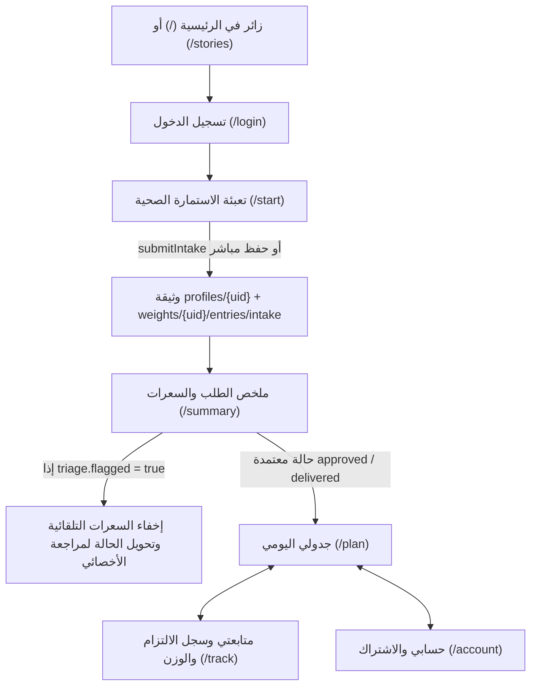

# المرجع المعماري والبرمجي الشامل لمنصة «متوازي» (ARCHITECTURE.md)

> **الغرض من هذا المرجع:** يوثّق هذا الملف الهيكلة البرمجية الفعلية لمنصة **متوازي (`motawazi.com`)** بعد التدقيق المباشر لكافة ملفات الكود المصدري. صُمّم ليكون المرجع الأول لصاحب المشروع ولأي مطور أو نموذج ذكاء اصطناعي قبل إجراء أي تعديل برمجي، بما يمنع التخمين أو كسر الترابط بين الصفحات وقاعدة البيانات ونظام البناء.

---

## 1. نظرة عامة وتكامل ملفات التوثيق

منصة **متوازي** هي تطبيق ويب عربي (`RTL`، الجوال أولاً، خط `Tajawal`) يقدم خطط نزول وزن مزدوجة المسار: **جدول غذائي موزون + جدول رياضي آمن للمفاصل يسيران بشكل متوازٍ**.

تتكامل وثائق المشروع الثلاث على النحو التالي:
| الملف | دوره المرجعي |
| :--- | :--- |
| `CLAUDE.md` | القواعد التشغيلية، السياسات الطبية والصحية المعتمدة، وقرارات المنتج. |
| `STACK.md` | حقائق الاستضافة (Cloudflare Pages)، إعدادات إقليم Firebase، ومفاتيح النشر. |
| `ARCHITECTURE.md` | **(هذا الملف)** الهيكلة البرمجية التفصيلية، مخططات البيانات، ربط الملفات، الدوال، آليات الاستدعاء، ونقاط الحذر الحرجة. |

### الركائز التقنية المعتمدة:
- **الواجهة الأمامية (Frontend):** HTML5 + CSS3 (`style.css`) + Vanilla JavaScript (ES5/ES6 متوافق بدون أطر عمل خارجية ولا حزم بناء معقدة).
- **الاستضافة الأمامية:** Cloudflare Pages تخدم مجلد الإخراج `dist/` الناتج حصراً عن سكربت `build_site.sh`، بصيغة روابط نظيفة بدون امتداد `.html` (مثل `/plan`، `/start`، `/account`).
- **الخدمات السحابية (Backend & DB):** مشروع Firebase مستقل خاص بمتوازي (`motawazi-prod`) في إقليم الدمام **`me-central2`** (يشمل Firebase Auth + Cloud Firestore + Cloud Functions v2 على Node.js 22).
- **بوابة الدفع:** ميسر (**Moyasar**) بنظام الفواتير المستضافة (`POST /v1/invoices`) + إشعار الويب-هوك الخادمي (`moyasarWebhook`).

---

## 2. خريطة المجلدات والملفات الكاملة

```text
motawazi/
├── index.html                  # صفحة الهبوط الرئيسية، المميزات، ملخص التجارب، والباقات
├── stories.html                # صفحة قصص النجاح وتجارب المشتركين المصنفة مع تبويبات الفلترة
├── login.html                  # تسجيل الدخول وإنشاء الحساب (Google + البريد وكلمة المرور)
├── start.html + start.js       # الاستمارة الصحية التفاعلية متعددة الخطوات
├── summary.html                # ملخص الطلب، مراحل الاعتماد، والسعرات والماكروز التقديرية
├── plan.html                   # لوحة جدول المشترك (7 أيام: وجبات + تمارين مسارين + تتبع يومي + طباعة PDF)
├── track.html                  # لوحة المتابعة (تقويم الالتزام الشهري، السلسلة، وسجل الوزن)
├── account.html                # إدارة الحساب، حالة الاشتراك، استعراض الباقات، وحالة الاستمارة
├── terms.html / privacy.html   # الشروط والأحكام وسياسة الخصوصية
├── 404.html                    # صفحة الخطأ 404 المخصصة لـ Cloudflare Pages
├── style.css                   # الهوية البصرية الموحدة وتنسيقات التطبيق المتجاوبة
├── firebase-config.js          # تهيئة اتصال المتصفح بمشروع Firebase (تضبط window.FB_READY = true)
├── auth.js                     # غلاف المصادقة الموحد (window.Auth) وقراءة حالة الاشتراك من users/{uid}
├── build_site.sh               # سكربت بناء مجلد النشر dist/ بنظام قائمة السماح الصارمة (Allowlist)
├── meals.json                  # نسخة الجذر لبنك الوجبات (200 وجبة) — يجب أن تطابق functions/meals.sa.json
├── workouts.json               # نسخة الجذر لجدول التمارين (7 أيام × مسارين)
├── config/
│   └── workouts.json           # نسخة التمارين في مجلد config المحلي
├── functions/                  # الدوال السحابية ومنطق الخادم النقي (Cloud Functions v2)
│   ├── index.js                # نقطة تصدير الدوال الثلاث: createPayment, moyasarWebhook, submitIntake
│   ├── config.js               # الإقليم (me-central2)، الأصول المسموحة (CORS)، وتعريف الأسرار
│   ├── nutrition.config.json   # المصدر الوحيد لمعاملات التغذية والحدود الصحية والماكروز
│   ├── countries.json          # قائمة الدول المدعومة في الاستمارة
│   ├── meals.sa.json           # المصدر الفعلي للوجبات الذي يُنسخ إلى dist/config/meals.json وقت البناء
│   ├── nutrition.js            # وحدة نقية: التحقق من الاستمارة، معادلة Mifflin-St Jeor، والفرز الصحي
│   ├── intake.js               # دالة submitIntake لحفظ الاستمارة وأول وزن في معاملة ذرية
│   ├── mealEngine.js           # محرك توليد وتبديل وتحجيم الوجبات على الخادم
│   ├── plans.js                # المصدر الوحيد لتعريف الباقات وأسعارها (بالهللات) ومددها
│   ├── moyasar.js              # عميل الاتصال بواجهة ميسر البرمجية (/v1/invoices)
│   ├── createPayment.js        # دالة إنشاء طلب الدفع وإعادة استخدام الفاتورة المعلقة
│   ├── verify.js               # وحدة نقية للقرارات المالية الحساسة ومطابقة المبالغ والتوقيع الزمني
│   ├── webhook.js              # دالة moyasarWebhook لتفعيل الاشتراكات في users/{uid}
│   └── test.js                 # حزمة الاختبارات الشاملة لمنطق التغذية والفرز والدفع (بدون شبكة)
├── firestore.rules             # قواعد أمان قاعدة البيانات السحابية
├── firestore.indexes.json      # الفهارس المركبة (مثل orders: uid ASC, createdAt DESC)
├── tests/rules.test.js         # اختبارات قواعد أمان Firestore على المحاكي
└── .github/workflows/firebase.yml # أنبوب الاختبار والنشر التلقائي (CI/CD)
```

---

## 3. رحلة المشترك وتدفق الصفحات والمصادقة



### تسلسل تحميل المصادقة في كافة صفحات التطبيق المحمية:
تعتمد جميع الصفحات المحمية (`start`, `summary`, `plan`, `track`, `account`) الترتيب الإلزامي التالي للسكربتات قبل كود الصفحة:
1. حزم `firebase-app-compat.js` ثم `firebase-auth-compat.js` ثم `firebase-firestore-compat.js` (و`firebase-functions-compat.js` في `start` و`account`).
2. ملف `/firebase-config.js`  يهيئ التطبيق ويضبط المتغير العام `window.FB_READY = true`.
3. ملف `/auth.js`  ينشئ الكائن العام `window.Auth`:
   - ينتظر `onAuthStateChanged`.
   - عند وجود مستخدم: يستدعي `touchProfile(u)` لحفظ `name` و`email` و`updated` في `users/{uid}`، ثم يستدعي `loadSub(u)` لقراءة `subscribed` و`subEndsAt` و`plan` من `users/{uid}` وحساب `Auth.isSubscribed`، ثم يُطلق `Auth.onChange(cb)` مع ضبط `Auth.resolved = true`.
4. **قاعدة هامة:** تبدأ الصفحة منطقها دائماً داخل `window.addEventListener("load", start)` لضمان انتهاء تهيئة `Auth.ready` وعدم ظهور خطأ *«الخدمة غير متاحة حالياً»* بسبب سباق التحميل.

---

## 4. محرك الاستمارة الصحية وحساب السعرات (`start.js` + `functions/nutrition.js`)

### أ. مصدر الإعدادات الغذائية الموحد:
- جميع الأرقام والمعاملات الغذائية تعيش حصراً في `functions/nutrition.config.json`.
- أثناء البناء، ينسخ `build_site.sh` هذا الملف إلى `dist/config/nutrition.json`، وينسخ `functions/countries.json` إلى `dist/config/countries.json` ليقرأهما المتصفح في `start.js` عبر `loadConfig()`.

### ب. معادلة حساب الاحتياج اليومي (`computeCalc`):
1. **معدل الأيض الأساسي (Mifflin-St Jeor):**
   - للذكور: `10 × الوزن(كجم) + 6.25 × الطول(سم) - 5 × العمر + 5`
   - للإناث: `10 × الوزن(كجم) + 6.25 × الطول(سم) - 5 × العمر - 161`
2. **إجمالي الطاقة اليومية (`TDEE`):** `BMR × activityFactors[activity]` (`sedentary: 1.2`, `light: 1.375`, `moderate: 1.55`, `high: 1.725`).
3. **خصم عجز الهدف (`deficit`):**
   - هدف نزول الوزن (`lose`): حسب السرعة المختارة (`slow: 250`, `moderate: 500`, `faster: 750` سعرة).
   - هدف المحافظة (`maintain`): `0`.
4. **صمام الأمان الأدنى (`minCalories`):**
   - لا تنزل السعرات مطلقاً تحت **1200 سعرة للإناث** و**1500 سعرة للذكور**، ثم تُقرّب لأقرب `roundKcalTo` (`10` سعرات) مع ضمان عدم كسر الحد الأدنى بعد التقريب.
5. **توزيع الماكروز بالجرامات:**
   - البروتين: `25%` من السعرات ÷ `4` سعرات/جم.
   - الكربوهيدرات: `45%` من السعرات ÷ `4` سعرات/جم.
   - الدهون: `30%` من السعرات ÷ `9` سعرات/جم.

### ج. منطق الفرز الصحي (`triage`):
تُعلَّم وثيقة المشترك (`triage.flagged = true`) لإخفاء السعرات الآلية في `summary.html` وتحويلها لتدقيق الأخصائي إذا تحقق أي سبب من الأسباب التالية:
- إجابة «نعم» على أي من الحالات السبع: `diabetes` (السكري)، `hypertension` (الضغط)، `heart` (القلب)، `kidneyLiver` (الكلى/الكبد)، `pregnancy` (الحمل/الرضاعة)، `surgery` (عمليات سابقة مثل التكميم)، `eatingDisorder` (اضطرابات الأكل).
- تناول أدوية حالية (`medications.has === true`).
- القاصرون (`minor`) في حال تفعيل موافقة ولي الأمر مستقبلاً (`guardian.enabled`).
- مؤشر كتلة الجسم `BMI` أقل من `18.5` أو يساوي/يتجاوز `40`، أو مؤشر الوزن المستهدف أقل من `18.5`.

### د. مسار الحفظ المزدوج في `start.js`:
1. يرسل المتصفح الإجابات أولاً إلى الدالة السحابية `submitIntake` في إقليم `me-central2`.
2. إذا نجحت الدالة، تتحقق وتفرز وتحفظ في معاملة واحدة (`runTransaction`) داخل `profiles/{uid}` و`weights/{uid}/entries/intake`.
3. **احتياطي المتصفح (`directFirestoreSave`):** إذا تعذر الوصول لدالة السحابة (غير منشورة بعد)، يحسب `start.js` المعادلات محلياً (`computeClientCalc` و`computeClientTriage`) ويحفظ الوثيقتين مباشرة في Firestore بصلاحية المالك.

---

## 5. محرك الوجبات وبنك الأكلات (`meals.sa.json` + `plan.html` + `mealEngine.js`)

### 🔴 مسار الملفات والاستدعاء (معلومة حرجة جداً عند التعديل):
1. **ملف المصدر الفعلي للإنتاج:** هو `functions/meals.sa.json`!
2. يقوم `build_site.sh` (السطر 51) بنسخ `functions/meals.sa.json` إلى `dist/config/meals.json`.
3. يوجد أيضاً `meals.json` في جذر المشروع كنسخة مطابقة؛ **عند إضافة أو تعديل أي وجبة، يجب تحديث `functions/meals.sa.json` و`meals.json` معاً** حتى يظهر التعديل في الموقع المنشور وفي الدوال السحابية.
4. في `plan.html`، تستدعي دالة `loadMealsDB()` المسار `/config/meals.json` (ومنه تملأ المتغير العام `MEALS_DATA = data.meals`).

### هيكلة كائن الوجبة الواحدة (Meal Schema):
يتوزع الكائن `meals` إلى 4 مصفوفات رئيسية (`breakfast`, `lunch`, `dinner`, `snack`) بمجموع **200 وجبة**:
```json
{
  "id": "sa_b_shakshouka",
  "name": "شكشوكة منزلية بالخضار مع خبز بر",
  "category": "breakfast",
  "description": "بيضتان مطبوختان بطماطم وبصل وفلفل رومي مع نصف رغيف خبز بر",
  "portion": "صحن متوسط + نصف رغيف بر",
  "portionUnit": "صحن ونصف رغيف",
  "scaleWeightText": "110 جم بيض (2 بيضة كاملة) + 50 جم خبز بر (نصف رغيف) + 120 جم خضار شكشوكة",
  "scaleWeights": [
    { "item": "بيض كامل", "weight": "110 جم", "household": "2 بيضة كاملة" }
  ],
  "baseCalories": 420,
  "macros": { "protein": 22, "carbs": 42, "fat": 18 },
  "tags": ["شعبي", "سريع", "اقتصادي", "عالي_البروتين"],
  "prepTimeMinutes": 12,
  "preparationSteps": ["الخطوة 1...", "الخطوة 2..."]
}
```

### آلية توزيع وتحجيم الوجبات في `plan.html`:
1. **تحديد سعرات المشترك (`userTargetKcal`):** تُقرأ من `profiles/{uid}.calc.kcal` (والافتراضي الآمن عند غيابها `1800` سعرة).
2. **نسب توزيع الفترات (`SLOT_NAMES`):**
   - الفطور (`breakfast`): **`25%`** (`0.25`)
   - الغداء (`lunch`): **`40%`** (`0.40`)
   - العشاء (`dinner`): **`25%`** (`0.25`)
   - السناك (`snack`): **`10%`** (`0.10`)
3. **معادلة التحجيم الذكي (`scaleMeal(meal, targetSlotKcal)`):**
   - يُحسب المعامل `factor = targetSlotKcal / meal.baseCalories`.
   - يُقيّد المعامل (`clamped`) بين **`0.75`** كحد أدنى و**`1.35`** كحد أقصى حتى تظل الحصص الغذائية واقعية ومنطقية للطبخ.
   - تُضرب `baseCalories` و`macros` (`protein`, `carbs`, `fat`) في `clamped` وتُقرّب لأقرب عدد صحيح.
4. **التنويع الأسبوعي والتبديل (`dayPlansCache`):**
   - لكل يوم `dayIdx` (من `0` إلى `6`)، تُختار الوجبة الافتراضية بالمعادلة `pool[dayIdx % pool.length]`.
   - عند ضغط زر **«اختر على ذوقك 📋»** (`openMealPicker`)، تُفتح نافذة بحث وفلترة فورية تدعم تطبيع الأحرف العربية (`normalizeArabic` لتوحيد الألف والهاء والياء وإزالة التشكيل) وزر اختيار عشوائي (`btnRandomPick`)، وتُحفظ الوجبة المختارة لليوم في `dayPlansCache[currentDayIndex][slotKey]`.

---

## 6. محرك التمارين المزدوج (`plan.html` + `workouts.json`)

### 🔴 مسار الملفات والاستدعاء (معلومة حرجة جداً عند التعديل):
1. تحاول دالة `loadWorkoutsDB()` في `plan.html` جلب `/config/workouts.json` ثم `/workouts.json`، وعند الفشل تستخدم المصفوفة المضمّنة مباشرة داخل `plan.html` باسم **`DEFAULT_WORKOUTS_DATA`**.
2. **تنبيه هام:** لأن سكربت `build_site.sh` الحالي لا ينسخ `workouts.json` إلى `dist/config/workouts.json`، فإن الموقع المنشور على Cloudflare Pages يعتمد فعلياً على **`DEFAULT_WORKOUTS_DATA` المضمّنة داخل `plan.html`**!
3. لذلك عند تعديل أي تمرين أو إضافة روابط فيديو: **يجب تحديث `DEFAULT_WORKOUTS_DATA` داخل `plan.html` بالتوازي مع `workouts.json` و`config/workouts.json`** (أو إضافة نسخ `workouts.json` في `build_site.sh`).

### هيكلة بيانات التمارين:
مصفوفة من **7 عناصر** (اليوم 1 حتى اليوم 7)، يحتوي كل يوم على مسارين متكاملين:
- **`home` (مسار منزلي بدون أجهزة):** تمارين مقاومة بوزن الجسم والكرسي والجدار + مشي منزلي منخفض الصدمات.
- **`gym` (مسار النادي الرياضي):** تمارين أجهزة عزل آمنة للمفاصل وكابلات ودمبلز + كارديو منخفض الشدة (`LISS`).
- يُحفظ اختيار المشترك للمسار (`home` أو `gym`) تلقائياً في المتصفح عبر `localStorage` بالمفتاح: `motawazi_workout_track`.

```json
{
  "day": 1,
  "dayLabel": "اليوم 1",
  "home": {
    "title": "مقاومة منزلية لكامل الجسم + تنشيط مسار الحرق",
    "target": "إيقاظ العضلات الكبيرة، حماية المفاصل، وتحفيز الأيض",
    "level": "مبتدئ متدرج",
    "durationMinutes": 30,
    "estCalories": 210,
    "warmup": "نص الإحماء...",
    "exercises": [
      {
        "name": "سكوات بملامسة الكرسي (Box Squat)",
        "targetMuscle": "عضلات الفخذ الأمامية والخلفية والمؤخرة",
        "sets": 3,
        "reps": "10-12 تكرار",
        "restSeconds": 60,
        "tip": "توجيه الكابتن للأداء الآمن..."
      }
    ],
    "cooldown": "نص الإطالات والتهدئة..."
  },
  "gym": { "...نفس البنية تماماً..." }
}
```

---

## 7. استشعار الوقت، الالتزام اليومي، وسجل الوزن (`plan.html` + `track.html`)

### أ. استشعار اليوم وانقلاب منتصف الليل:
- تبدأ مصفوفة الأسبوع في `plan.html` من يوم السبت:
  `ARABIC_DAY_NAMES = ["السبت", "الأحد", "الاثنين", "الثلاثاء", "الأربعاء", "الخميس", "الجمعة"]` (حيث `0 = السبت` و`6 = الجمعة`).
- تحسب دالة `getTodayDayIndex()` اليوم الحالي وفق **توقيت الرياض الرسمي (`Asia/Riyadh`, `UTC+3`)**:
  `new Date(Date.now() + 3 * 3600 * 1000).getUTCDay()` ثم `(jsDay + 1) % 7`.
- تراقب دالة `checkDayRollover()` تغيّر مفتاح التاريخ `todayKey` (`YYYY-MM-DD`) كل 45 ثانية وعند عودة التركيز للتبويب (`focus` / `visibilitychange`) لتصفير مهام اليوم الجديد تلقائياً دون الحاجة لتحديث الصفحة.

### ب. نظام المهام الـ 6 وتقفيل اليوم والسلسلة (`Daily Tracker`):
- يضم كل يوم **6 مهام متابعة**: `breakfast`، `lunch`، `dinner`، `snack`، `workout`، `water`.
- **قاعدة المرونة الذكية (`handleLockDay`):**
  - أقل من 3 مهام (`< 50%`): زر تقفيل اليوم غير مفعّل.
  - من **3 إلى 5 مهام (`50%+`)**: يُسمح بتقفيل اليوم ويُحتسب **يوماً مقفلاً ناجحاً (🔥)** ويزيد عداد السلسلة (`streak`).
  - إتمام **6 من 6 مهام (`100%`)**: يُحتسب **يوماً ذهبياً (🌟)** في تقويم الالتزام الشهري داخل `track.html`.
- **عداد السلسلة (`streak`):** يُحفظ داخل وثيقة `profiles/{uid}` بالحقل `streak: { count, lastDate }`؛ يزيد بمقدار `1` إذا كان `lastDate === yesterdayKey`، ويُعاد إلى `1` إذا انقطعت الأيام.

### ج. خريطة التخزين المحلي (`localStorage` & `sessionStorage`) ومزامنتها:
| المفتاح في المتصفح | الصفحة المسؤولة | الوظيفة والمزامنة السحابية المقابلة |
| :--- | :--- | :--- |
| `sessionStorage["mtz_intake_" + uid]` | `start.js` | حفظ مؤقت لخطوات الاستمارة أثناء التعبئة؛ يُحذف فور الإرسال الناجح. |
| `localStorage["motawazi_workout_track"]` | `plan.html` | تذكّر المسار الرياضي المفضل للمشترك (`"home"` أو `"gym"`). |
| `localStorage["motawazi_trk_" + uid + "_" + YYYY-MM-DD]` | `plan.html` + `track.html` | كاش فوري لمهام اليوم الـ 6؛ يتزامن ثنائياً مع `profiles/{uid}/tracking/{YYYY-MM-DD}` في Firestore. |
| `localStorage["mtz_weights_" + uid]` | `track.html` | حفظ قراءات الوزن الأسبوعية المضافة من صفحة المتابعة (مع قراءة وزن البداية والهدف من `profiles/{uid}.answers`). |

---

## 8. هيكل قاعدة البيانات السحابية وقواعد الأمان (`firestore.rules`)

تعتمد القواعد مبدأ **«المنع الافتراضي الشامل إلا ما سُمح به صراحةً لصاحب الحساب `owns(uid)`»**:

| المسار في Firestore | الحقول الرئيسية | صلاحية القراءة | صلاحية الكتابة من المتصفح | صلاحية الخادم (Admin SDK) |
| :--- | :--- | :--- | :--- | :--- |
| `users/{uid}` | `name`, `email`, `updated` + حقول الاشتراك: **`subscribed`**, **`subEndsAt`**, **`plan`** | المالك فقط | إنشاء وتحديث كل الحقول **ما عدا حقول الاشتراك الثلاثة** (ممنوعة قطعياً على المتصفح؛ الحذف ممنوع) | **`moyasarWebhook` وحده** يكتب `subscribed`, `subEndsAt`, `plan` |
| `profiles/{uid}` | `uid`, `answers`, `calc`, `triage`, `status`, `consent`, `guardian`, `streak`, `createdAt`, `updatedAt` | المالك فقط | إنشاء وتحديث للمالك (لدعم الحفظ الاحتياطي وتحديث `streak`) | `submitIntake` تنشئ/تستبدل الوثيقة طالما الحالة `received` |
| `profiles/{uid}/tracking/{date}` | `breakfast`, `lunch`, `dinner`, `snack`, `workout`, `water`, `completedCount`, `percent`, `locked`, `lockedAt` | المالك فقط | إنشاء وتحديث للمالك | — |
| `weights/{uid}/entries/{entryId}` | `weightKg`, `source` (`"intake"`), `date` | المالك فقط | إنشاء وتحديث للمالك | `submitIntake` تكتب الوثيقة `intake` |
| `orders/{orderId}` | `uid`, `plan`, `days`, `amount`, `status`, `applied`, `invoiceId`, `invoiceUrl`, `moyasarId`, `live`, `createdAt`, `paidAt` | المالك فقط (`resource.data.uid == auth.uid`) | **ممنوعة إطلاقاً (`allow write: if false`)** | `createPayment` تنشئ الطلب، و`moyasarWebhook` يحدّث حالته |

### حالات مراجعة الملف الصحي (`profiles/{uid}.status`):
`received` ⬅ `under_review` ⬅ `approved` ⬅ `delivered`.
- في الوضع الحالي للكود، تتحقق صفحات `plan.html` (السطر 3364) و`account.html` (السطر 430) و`summary.html` (السطر 286) من الشرط:
  `isApproved = (status === "approved" || status === "delivered")`.
- أي حساب جديد يُنشأ عبر `submitIntake` يأخذ الحالة `"received"`، فيظهر له في `/plan` صندوق الانتظار `#lockedPlanState` (*«جدولك قيد المراجعة والاعتماد»*) إلى أن تتغير حالته إلى `"approved"`.

---

## 9. الباك إند وبوابة الدفع ميسر (`functions/`)

### أ. جدول الباقات (`functions/plans.js`):
- **المصدر الوحيد للسعر والمدة على الخادم:** لا يقبل الخادم أي سعر أو عدد أيام من المتصفح إطلاقاً (بل يسجّل تحذيراً أمنياً إذا أُرسلت).
- الباقات المعرّفة حالياً (`basic`, `followup`, `intensive`) مدة كل منها `30` يوماً، والمبالغ مضبوطة مؤقتاً على `amount: null` (الأسعار بالهللات عند التفعيل، مثلاً `14900` = 149 ريال). تمنع دالة `isSellable(p)` إنشاء أي فاتورة لباقة سعرها `null`.
- نسخة العرض البصري في `account.html` (مصفوفة `PLANS`) و`index.html` هي للعرض فقط ويجب مطابقتها يدوياً مع `functions/plans.js` عند تحديد الأسعار.

### ب. دورة الدفع والتفعيل الآمن (`createPayment` ⬅ `moyasarWebhook`):
1. **إنشاء الطلب (`createPayment.js`):**
   - يتحقق أولاً من عدم وجود طلب معلّق طازج لنفس المستخدم ونفس الباقة خلال آخر 15 دقيقة (`REUSE_WINDOW_MS`) عبر الفهرس المركب (`uid` + `createdAt`) لمنع الفواتير المكررة عند الضغط المزدوج.
   - ينشئ وثيقة `orders/{orderId}` بحالة `status: "pending"` وحارس التكرار الصريح `applied: false` **قبل** الاتصال بميسر.
   - ينشئ فاتورة ميسر عبر `moyasar.js` (`POST https://api.moyasar.com/v1/invoices`) ويحفظ `invoiceId` و`invoiceUrl` في الوثيقة.
2. **معالجة إشعار الدفع (`webhook.js` + `verify.js`):**
   - يتحقق أولاً من `secret_token` بمقارنة ثابتة الزمن عبر بصمة `SHA-256` (`safeEqual`) ويرد بـ `401` لأي طلب غير مصرح.
   - يتحقق من تطابق وضع الحدث (`body.live`) مع نوع المفتاح السري (`isLiveKey` — وجود `_test_` يعني اختبار) لمنع تفعيل اشتراك حقيقي برسالة اختبارية.
   - يربط الحدث بوثيقة الطلب داخل معاملة Firestore (`runTransaction`) عبر البحث بحقل `invoiceId` أولاً ثم `metadata.orderId` احتياطاً (لأن ميسر لا تنقل `metadata` الفاتورة دائماً لكائن الدفع).
   - تتحقق دالة `decidePaid` النقية من أن `order.applied !== true` (مما يضمن عدم تكرار التفعيل لو أرسلت ميسر الإشعار 6 مرات)، ومن تطابق `invoice_id` والمبلغ بالهللات (`amount`).
   - تحسب `nextSubEndsMs` تاريخ الانتهاء الجديد بإضافة أيام الباقة إلى الرصيد المتبقي إن كان الاشتراك سارياً، أو إلى وقت الخادم الحالي إن كان منتهياً، وتحدث `orders/{orderId}` و`users/{uid}` معاً في نفس المعاملة الذرية.
   - يعالج الحدث `payment_faild` (مكتوب بهذا الهجاء المتعمد لمطابقة حدث ميسر الفعلي) لتسجيل الفشل على الطلبات المعلقة فقط دون المساس باشتراك سارٍ.

---

## 10. نظام البناء والاختبارات والقواعد التحذيرية الذهبية

### أ. أوامر الفحص والبناء الأساسية:
1. **تشغيل اختبارات الخادم والتغذية والدفع (إلزامي قبل أي رفع يمس المنطق):**
   ```bash
   node functions/test.js
   ```
2. **بناء مجلد النشر للتحقق من سلامة قائمة السماح وعدم تسرب ملفات الخادم:**
   ```bash
   bash build_site.sh
   ```

### ب. ⚠️ التحذيرات الذهبية الـ 7 (اقرأها قبل أي تعديل برمجي):

1. **قاعدة إضافة أي صفحة جديدة:**
   كل ملف `.html` أو `.js` جديد للواجهة يجب إضافته صراحةً إلى مصفوفة `PUBLIC_FILES` داخل `build_site.sh`، وإلا لن ينتقل إلى `dist/` وسيعطي خطأ `404` على موقع الإنتاج `motawazi.com`.
2. **انتبه لمجلد `dist/` عند حفظ الصور والفيديوهات (تحذير حرج):**
   مجلد `dist/` مستبعد في `.gitignore` ويقوم السطر `rm -rf "$OUT"` في `build_site.sh` **بمسحه بالكامل** عند كل عملية بناء! لا تضع ملفات أصلية (مثل فيديوهات وصور التمارين `img/exercises/`) داخل `dist/` وحده؛ يجب حفظ الأصول الثابتة في مجلد مصدري بالجذر (مثل `assets/` الذي ينسخه `build_site.sh` تلقائياً، أو `img/` مع إضافة سطر نسخه في `build_site.sh`).
3. **تطابق نسختي بنك الوجبات:**
   تعديل `meals.json` في الجذر وحده **لا يغيّر شيئاً في الإنتاج** لأن `build_site.sh` ينسخ `functions/meals.sa.json` إلى `dist/config/meals.json`. حدّث الملفين معاً دائماً.
4. **تطابق بيانات التمارين:**
   تعديل `workouts.json` وحده لا يظهر في الإنتاج ما لم تُحدَّث مصفوفة `DEFAULT_WORKOUTS_DATA` داخل `plan.html` (أو يُضف نسخ `workouts.json` إلى `dist/config/workouts.json` داخل `build_site.sh`).
5. **فخ `fetch()` مع أخطاء 404 في المتصفح:**
   دالة `fetch("/path")` لا ترفض الوعد (`reject`) عند رجوع خطأ `404`، بل تُكمل بصفحة HTML فتفشل `res.json()`. عند كتابة مسار بديل (Fallback)، افحص دائماً `if (!res.ok) throw new Error(res.status)` قبل استدعاء `res.json()`، واحرص على وجود بيانات احتياطية آمنة حتى لا تتوقف `renderDayPlan()`.
6. **بوابة حالة اعتماد الملف (`status === "approved"`):**
   صفحة `plan.html` تفحص حالياً `p.status === "approved" || p.status === "delivered"`. طالما لا توجد لوحة تحكم أخصائي لتغيير الحالة من `"received"` إلى `"approved"`، انتبه عند اختبار حساب جديد أو تعديل منطق القفل حتى لا يُحجب المشتركون الجدد عن جداولهم دون قصد.
7. **تطابق إقليم الدوال السحابية (`REGION`):**
   قيمة الإقليم `"me-central2"` يجب أن تبقى متطابقة تماماً في الأماكن الثلاثة: `functions/config.js`، و`start.js`، و`account.html`، ومطابقة لإقليم قاعدة بيانات Firestore.
